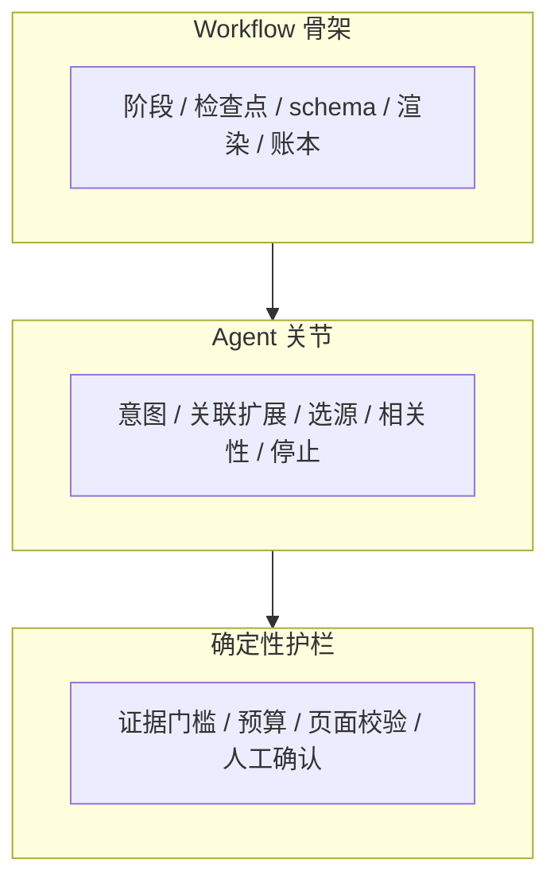
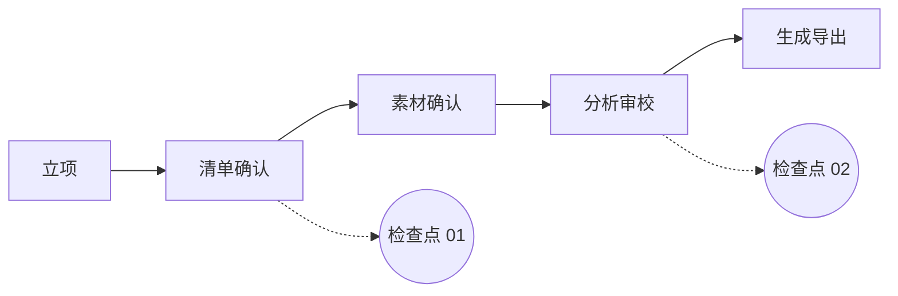
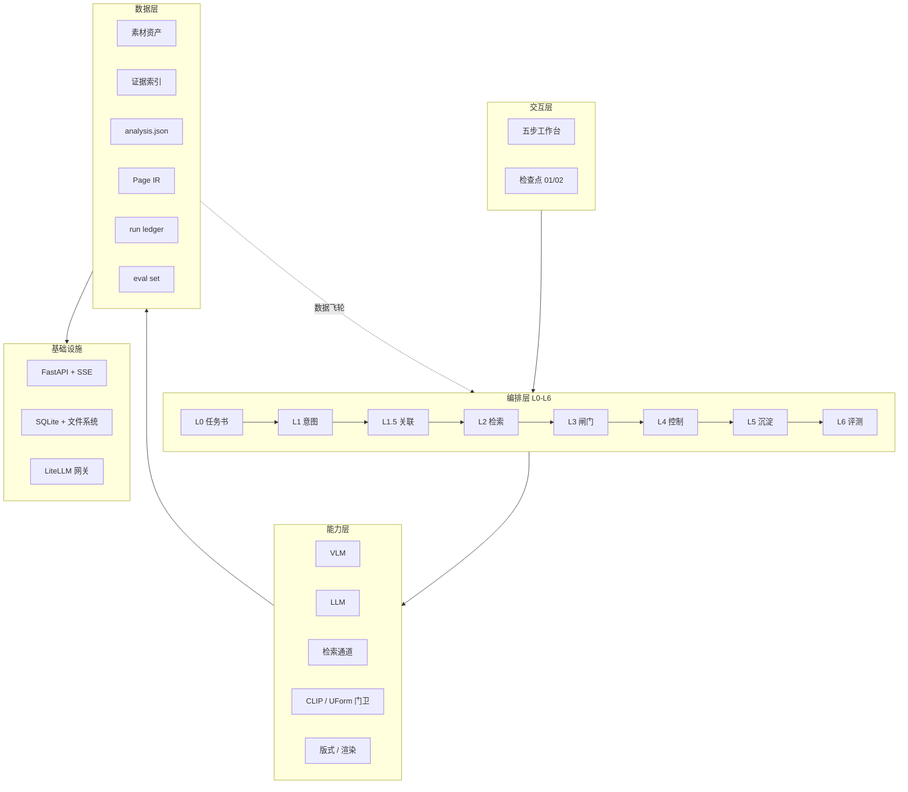

# EquipLens-AI 产品说明书 v3 · 文字稿

> 基于 `PAGE-PLAN-v3.md`，新增 P07「端到端业务流程」页；P13 升级为「整体编排与技术栈」全页图；新增 P14「数据飞轮」页。总页数调整为 **21 页**。
> 新增原因：业务流程必须可视化；技术栈与整体编排需要一张可读的总装图；每次项目的沉淀数据需要作为独立资产被复用。
>
> 写作口径：
> - 使用 AI 产品经理语言：问题域、价值主张、产品形态、核心链路、交付契约、证据等级、评测闭环。
> - 不写防御性内容：不预判质疑、不反复解释“为什么不是”，只写推进叙事的判断与证据。
> - 数字标注目标 / 实测 / 验收；实测标样本量与日期。
> - 竞品可点名；真实截图与案例素材已确认可对外使用。

---

## P01｜封面

**主标题**：EquipLens-AI 产品说明书

**副标题**：面向工程车辆外观部件设计前期分析的可控报告生成系统

**一句话定义**：输入设备类别、关注部件与页数预算，输出可编辑的竞品分析报告。

**文档信息**
- 版本：v1.0
- 日期：2026.10
- 适用对象：设计团队 / 产品与研发 / 合作客户
- 文档属性：对外产品说明书

**视觉**
- 真实工程车辆主图 + 技术取景框 + 色彩占比条。
- 不写品牌口号；封面只保留定义句。

---

## P02｜01 产品定义：设计前期的竞品分析报告

**导语**
EquipLens-AI 服务的是工程车辆外观部件迭代项目的设计前期。它在第一轮造型方案开始之前，把竞品素材组织成一份可讨论、可修改的分析报告，用于和客户对齐设计风格与设计边界。

**图 P02-1｜报告在项目中的位置**

**使用环节**
- 阶段：外观部件迭代项目的设计前期，项目启动后、第一轮造型方案开始前。
- 对象：重卡、牵引车、自卸车、起重机、矿用车辆、专用车等工程车辆。
- 读者：设计团队、设计管理、企业客户评审人。
- 场景：客户汇报会、内部立项评审、前期方向讨论。

**报告目的**
- 对齐设计风格与设计边界。
- 明确竞品在同类部件上的做法、共性与差异。
- 让客户在进入第一轮造型前形成共同判断。
- 报告不包含第一轮造型方案。

**输入 / 输出**

| 输入 | 输出 |
|---|---|
| 设备类别、关注部件、竞品范围、页数预算 | 竞品清单与页序 |
| 客户资料、品牌规范、历史项目 | 单车分析页 |
| 甲方素材、展会照片、网络素材 | 可编辑 PPTX（主）/ PDF（辅） |

**边界**
- 做：竞品与部件级分析、清单与页序规划、可编辑版面、来源可追溯。
- 不做：第一轮造型方案、替代设计师判断、整页贴图、无证据结论。

**成功标准**
- 报告制作周期：3–5 天 → ≤1 天（目标）。
- 单车页直接采用率：≥60%（目标）。
- 导出元素可编辑率：100%（验收）。

---

## P03｜02 用户与现状：前期分析报告的现有生产流程

**导语**
这份报告目前由工业设计师主责，设计管理与前期调研协同，最终用于客户汇报。它的生产流程高度依赖个人经验，工具之间没有形成数据链路。

**角色**

| 角色 | 职责 | 关注点 |
|---|---|---|
| 工业设计师 | 主责：找素材、读图、写分析、排版 | 快速拿到可改的初稿，判断不被格式劳动挤占 |
| 设计管理 / 前期调研 | 协同：定范围、评审、对客户 | 覆盖全面、结论站得住、进度可控 |
| 企业客户 | 评审：看报告、提修改 | 图文专业、观点清晰、来源可信 |
| 售前 / 方案 | 复用：给甲方做调研材料 | 版式像“人做的”、能直接讲 |

**现状 6 步**

| 阶段 | 现状动作 | 工具 / 协作 | 主要问题 |
|---|---|---|---|
| 接需求 | 明确设备类别、竞品范围、关注部件 | 项目会 / 客户输入 | 口径模糊，竞品边界靠经验 |
| 找素材 | 甲方提供 + 展会拍摄 + 网络收集 | 搜索引擎、图库、聊天记录 | 图散、背景乱、质量参差 |
| 整素材 | 筛选、去重、按车型/视角/部件归类 | 文件夹、PS、肉眼 | 耗时；型号识别靠人；缺主图 |
| 读图分析 | 看造型、色彩比例、部件、CMF，写分析 | PPT / Word / 通用网页 AI | 依赖个人经验，口径不统一 |
| 排版 | 一车一页，套母版，复制图文 | PowerPoint / WPS | 重复劳动；改字牵动整页 |
| 评审返工 | 内部评审、客户汇报、反复修改 | 邮件 / 会议 / PPT | 修改不可定位；版本散落 |
| 沉淀 | 报告留在个人电脑或历史项目 | 个人文件夹 | 下个项目从零开始 |

**图 P03-1｜现状流程**

**现有工具的组合方式**
- 素材：搜索引擎、图库、甲方资料、展会照片。
- 分析：PPT / Word 手写，通用网页 AI 辅助文案。
- 排版：PowerPoint / WPS 母版。
- 管理：文件夹、邮件、聊天记录。

**卡点**
- 素材不可复用：每次项目重新找图、重新归类。
- 分析口径不稳定：不同设计师对同一部件的描述不一致。
- 版式返工：改一个字、换一张图，可能牵动整页。
- 结论留不下来：分析结果散落在历史 PPT，无法结构化复用。

**替代方案与不足**
- 人工 + 通用网页 AI：能写文案，但不理解部件、版式与证据。
- 图库 + 人工整理：素材多，但分析与报告仍靠人。
- 通用 AI PPT：能排版，但没有竞品清单、证据链与设计分析 schema。

**结论**
工具已经很多，但彼此不成链路；报告仍然靠人拼接。

---

## P04｜03 核心价值：把前期分析变成可确认、可编辑、可追溯的生产线

**价值主张**
把前期分析从个人经验驱动变成可复用、可审计的生产线。

**核心链路**
清单 → 素材 → 分析 → 页面。每一段都有产物、有来源、可修改。

**四个价值点**

| 价值 | 现状 | 目标 / 验收 |
|---|---|---|
| 效率 | 3–5 天做一份 10–15 台竞品报告 | ≤1 天（目标） |
| 单车分析 | 人工读图、写文案、排版 | 20–40 秒 / 车（MVP 目标） |
| 质量 | 依赖个人经验，口径不一 | 部件命中 ≥85%、描述评分 ≥4/5（目标） |
| 可控 | 修改不可定位，版本散落 | 100% 元素可编辑、来源可追溯（验收） |

**从现状到目标**

| 环节 | 现状 | EquipLens-AI |
|---|---|---|
| 竞品清单 | 凭经验列，边界模糊 | 四轴扩展 + E3/E1 证据 + 页槽 |
| 素材 | 人工找图、整图 | 多通道检索 + 门卫 + 三篮子 |
| 分析 | 人工读图、写文案 | 结构化分析 + 部件卡 + 风格词 |
| 版面 | 一车一页手工排 | Page IR + 模板渲染 + 页面级修改 |
| 沉淀 | 历史 PPT 留在个人电脑 | 结构化 schema + 项目沉淀 |

**适用条件**
- 有 10 台左右可用竞品素材，关注部件明确。
- 客户接受“可编辑初稿”，而不是“一次成稿”。
- 设计团队愿意在检查点做确认，而不是把判断完全交给 AI。

**一句话**
把找图、整图、写分析、排版这些可标准化的劳动交给系统，把判断与客户沟通留给人。

---

## P05｜04 产品形态：workflow 骨架 + agent 关节的混合编排

**导语**
EquipLens-AI 采用 **Agent-augmented workflow（混合编排）**：workflow 负责骨架与交付，agent 负责关节判断，确定性护栏负责合规与可回退。

**三层结构**

| 层 | 负责什么 | 具体内容 |
|---|---|---|
| Workflow 骨架 | 保证可交付 | 阶段、检查点、schema、渲染、账本、robots/配额 |
| Agent 关节 | 处理长尾判断 | 意图解析、关联扩展、查询规划、来源选择、相关性判定、停止/重查 |
| 确定性护栏 | 保证合规与可回退 | 证据门槛、预算、页面模型校验、人工确认 |

**图 P05-1｜混合编排**

**一次请求怎么走**
输入“沙漠牵引车 + 踏步 / 防护栏 / 底盘”：
1. L1 解析意图：类目、部件、页数预算。
2. L1.5 关联扩展：同类目、邻近类目、同平台、环境特化。
3. L2 检索执行：文本与图片多通道，受 robots/配额约束。
4. L3 闸门：对象锚定、主题排除、具体性检查。
5. L5 结构化分析：部件、形态、CMF、设计意图。
6. Page IR：生成页面结构。
7. 渲染：PPTX / PDF / HTML。

**为什么是混合编排**
报告需要三件事同时成立：证据可审计、页面可回退、成本可控制。纯 Agent 的开放性会削弱前三者；纯 Workflow 的固定性又覆盖不了长尾类目与语义歧义。混合编排把两者分开：该写死的写死，该判断的判断。

**判断原则**
越接近“判断”，越交给模型；越接近“交付”，越写死。

---

## P06｜05 护城河与商业化：领域 schema、证据基础设施与数据飞轮

**导语**
通用 Agent 编排、通用 AI PPT 和图库+人工都能解决一部分问题，但它们的默认对象不是工程车辆的设计分析。EquipLens-AI 的差异在于把领域对象、证据和交付契约固定下来。

**对比矩阵**

> 下表只比较与本产品重叠的能力，不评价各产品的整体优劣。

| 维度 | 通用 Agent 编排（Manus / Dify / Coze） | 通用 AI PPT（Gamma / WPS AI / Canva） | 图库 + 人工（Pinterest / 花瓣 / 站酷） | EquipLens-AI |
|---|---|---|---|---|
| 领域对象 | 通用文档、网页、工具 | 通用幻灯片 | 图片素材 | 车型、部件、CMF、页型 |
| 任务边界 | 开放 | 开放 | 人工 | 前期分析报告，边界清晰 |
| 检索质量 | 通用搜索 | 弱 | 人工找图 | 多通道 + 门卫 + 证据分级 |
| 输出物 | 文本 / 动作 | 幻灯片 | 素材 | 可编辑分析页 + 报告 |
| 质量保证 | 靠 prompt | 靠模板 | 靠人 | 闸门 + 评测 + 检查点 |
| 成本 / 时延 | 不可预测 | 低 | 高 | 固定骨架，成本可测 |
| 数据资产 | 不留存 | 不留存 | 素材库 | 结构化沉淀 + 修正数据 |

**护城河六层**
1. **领域 schema**：分析三维度、部件词表、页型、品牌家族。
2. **证据基础设施**：E3/E1、闸门、来源索引、可回放。
3. **修正数据**：设计师裁框、改词、调版式留下的偏好数据。
4. **模板资产**：母版、版式规则、品牌适配。
5. **评测集**：把“好”定义成可回归的指标。
6. **数据飞轮**：素材、证据、分析、页面、修正数据与评测样本持续入库，下一次项目直接复用。

**商业化优势**
- 成本可测：单份报告成本可核算、可优化。
- 时延可预期：适合嵌入设计流程与客户交付节点。
- 可审计：满足企业客户对来源与合规的要求。
- 可集成：输出 PPTX/PDF/HTML，不锁定工作流。

**什么不是护城河**
模型本身、单点 prompt、一次性功能。这些会随通用能力商品化。

---

## P07｜06.0 端到端业务流程：五个阶段、两个检查点、三类产物

**导语**
一条报告生产线，必须让用户知道每一步在做什么、产物是什么、在哪里确认。EquipLens-AI 把流程固定为五个阶段，只在两个检查点要求人工介入。

**图 P07-1｜端到端流程**

**五个阶段**

| 阶段 | 用户动作 | 系统动作 | 产物 | 检查点 |
|---|---|---|---|---|
| S0 立项 | 输入设备类别、关注部件、页数预算 | 解析意图，建立项目 | `intent.json` | 无 |
| S1 清单确认 | 勾选、增删、调序 | 四轴扩展、证据校验、页槽分配 | `association-list.json` | 检查点 01 |
| S2 素材确认 | 自动检索或上传，三篮子归组 | 门卫、视角、质量分、聚类 | 每车图集 | 人工确认 |
| S3 分析审校 | 逐台审阅，改字/裁框/调版式 | VLM 分析、页面渲染 | `analysis.json` + `page.ir` | 检查点 02 |
| S4 生成导出 | 确认导出 | 渲染 PPTX / PDF / HTML | 报告文件 | 终检 |

**两个检查点**
- 检查点 01（清单）：推荐、方向级、备选分层；证据为空不可勾选；锁定后作为闭集。
- 检查点 02（成稿）：改字、换图、调版式；确认后才允许导出。

**三类产物**
- `intent.json`：项目意图与预算。
- `association-list.json`：竞品清单与证据。
- `analysis.json` + `page.ir`：单车分析与页面结构。

**回退与失败**
- 任意阶段可回改；下游标“需重算”，不静默丢失。
- 单台分析失败不阻断整批；标红、可跳过、可重试。
- 导出失败保留工程，可重试。

---

## P08｜06.1 关联推荐：把类目与部件要求转成页数受限的竞品清单

**导语**
工程车辆的长尾类目，难点在判断：哪些车算相关、哪些证据足够。关联推荐把这个问题拆成四轴扩展、证据分层与页槽分配。

**为什么难**
- 长尾类目没有完整名录；型号边界模糊；样本不足。
- 工程车辆的“同类”不只是车型名，还涉及平台、构型、工况、部件。
- 部件级需求可以跨车型取参照，但不能拿不相关的车硬凑。

**四轴扩展**

| 轴 | 问题 | 示例 |
|---|---|---|
| 同类目 | 同车型类别、同品牌家族 | 6×4 牵引车 → 同吨位/同品牌牵引车 |
| 邻近类目 | 用途相近、构型相近 | 牵引车 → 载货/自卸/专用底盘 |
| 同平台 | 驾驶室平台、底盘平台、驱动形式 | 6×6、8×8、同一驾驶室平台 |
| 环境特化 | 沙漠、矿区、高原、寒区 | 沙漠牵引车 → 沙漠环境用车 |

**清单分层**
- 推荐：E3，标题含型号的详情页。
- 方向级：provisional，必须写 `verify_by`，不得冒充具体车型。
- 备选：超量推荐转备选，转正才占页。

**页槽模型**
推荐 N + 备选 2–3；总页数 10–14 整车页；超出自动转备选。

**工程车辆示例**
沙漠牵引车：常规卡车头 + 沙漠环境用车 + 牵引车分层；踏步、防护栏、底盘才是环境相关部件。最终形成 9 推荐 + 3 备选，锁定 12 页。

**当前指标**
- 页槽填充率：85.4%（A/B 样例）。
- 真实验证率：9.4%。
- 下一阶段：补名录与证据索引，把 provisional 转成 recommended。

**图 P08-1｜四轴扩展与清单**
- 左侧：四轴同心圆或四象限。
- 右侧：清单样例表（车型 / 关联理由 / 证据等级 / 选择）。
- 下方：页槽分配条（推荐 / 方向级 / 备选）。

---

## P09｜06.2 内容获取：多通道检索、门卫筛选与素材池

**导语**
工程车辆素材的问题集中在可用性：图很多，但能当主图的很少。内容获取把“可用性”做成一条可执行的筛选链。

**为什么难**
- 来源：甲方提供、展会拍摄、网络收集；背景杂乱、质量参差、无分类。
- 识别：需要看 Logo、铭牌、构型、驾驶室、底盘，不是普通以图搜图。
- 归组：同一台车的多角度照片分散在不同来源，型号容易混。

**双通道**
- 自动检索：文本检索 + 图片检索；受 robots / 配额约束。
- 用户上传：兜底，允许人工准备素材。

**门卫检查**
1. 是不是工程车。
2. 是不是整车。
3. 视角：3/4、侧、前、后。
4. 分辨率、遮挡、背景杂乱度。
5. 部件特写不得冒充整车主图。

**三篮子**
整车 / 部件 / 其他；缺主图阻断；归不了组进“未归组”托盘。

**单批实测**
105 判定 → 70 保留 → 22 台有图 → 3 台缺主图。

**文本与图片的分工**
- 图片是证据：主图、部件图、视角、来源。
- 文本用于语汇、定调、事实补充；不用文本来替代看图。

**图 P09-1｜素材漏斗 + 三篮子**
- 上：105 → 70 → 22 → 3 的漏斗。
- 下：整车 / 部件 / 其他三列，标出“缺主图阻断”。

---

## P10｜06.3 结构化分析：把工程车辆外观拆成可复核的设计字段

**导语**
通用视觉模型能说出“这是一辆卡车”，但报告需要的是“格栅是横置多层、保险杠是分体式、轮拱是一体式同色”。结构化分析把设计语言拆成机器可校验、设计师可修改的字段。

**三维度**

| 维度 | 内容 | 用途 |
|---|---|---|
| 结构信息 | 形态、构型、比例、分块分缝 | 客观事实 |
| 设计信息 | CMF、姿态、特征线、部件族属 | 设计语言 |
| 设计意图 | 为什么这样设计、给用户什么价值 | 判断与汇报 |

**部件词表**
前脸、格栅、保险杠、侧防护、轮拱、踏步、灯具、品牌标识区等。

**每个部件的字段**
- 名称 / 别名
- 族属（钣金覆盖件 / 功能附件 / 型材框架件等）
- 形态
- CMF
- bbox
- 来源视图

**风格与色彩**
- 三词风格关键词。
- 主色 2–4 色与占比。

**AI 机制**
VLM 看图 → schema 约束 → 校验 → 失败重试 → 多视角合并；失败标 `needs_review`，不阻断整批。

**产物**
`analysis.json`：页面渲染与知识沉淀的公共合同。

**与通用图像描述的区别**
不是“这是一辆卡车”，而是“格栅是横置多层、保险杠是分体式、轮拱是一体式同色”。

**图 P10-1｜单车页解剖 + 字段映射**
- 真实单车页截图。
- 标注：风格词、色彩条、主图、前脸分析、部件卡、页脚、页码。
- 右侧：`analysis.json` 字段与页面槽位的对应关系。

---

## P11｜06.4 单车页：从结构化分析到一车一页的版面

**导语**
报告的说服力不只来自分析，也来自版面是否让客户在 30 秒内看懂一台车的造型特征。单车页把结构化字段组织成客户可读的版面。

**版式约束**
- 16:9，一车一页。
- 1–2 张主图。
- 3–4 个部件裁图。
- 左侧主图 + 前脸分析；右侧部件卡。
- 页眉：标题 + 品牌色下划线 + 三词风格。
- 页脚：车型 + 品类 + 页码。

**页面类型**
- 封面
- 单车页
- 局部设计分析
- 品牌设计分析
- 情绪版（P2 扩展）

**Page IR**
页面唯一事实源：版式、槽位、素材、文案、样式、来源。同一份 IR 渲染 PPTX / PDF / HTML。

**领域规则**
- 品牌家族与页序。
- 一车一页的阅读节奏。
- 部件卡的“名称 / 族属 / 形态 / CMF”写法。
- 页眉下划线跟随品牌主色。

**产物**
可编辑 PPTX；不是整页贴图。

**图 P11-1｜单车页与 Page IR**
- 左侧：真实单车页。
- 右侧：Page IR 槽位示意（hero / front_text / part_01–05 / footer）。

---

## P12｜06.5 审校与导出：页面级修改与可编辑交付

**导语**
设计师不会接受一份“看起来完成、但改不动”的报告。EquipLens-AI 的交付标准是：每个字、每张图、每个框都能改。

**三类修改**
- 裁框：在原图上调部件框，只影响该部件。
- 文字：点开就改，或让 AI 只重写这一段。
- 版式：拖块、缩放、吸附；文本自动缩字号。

**自然语言指令**
示例：“把第 3 页的‘厚重’改成‘敦实’，只改这一页。”
执行路径：定位到页 → 改 Page IR → 只重渲染该页。

**导出格式**

| 格式 | 定位 | 可编辑性 |
|---|---|---|
| PPTX | 可编辑主交付 | 文本 / 图片 / 形状原生对象 |
| PDF | 只读交付 | 版式固定，适合汇报/存档 |
| HTML | 翻页册 | 预览与分享，免安装 |

**导出检查**
- 原生对象，无整页贴图。
- Office / WPS 双验证。
- 目录页码一致。
- 工程可回退。

**图 P12-1｜裁框编辑器**
真实界面截图 + 右侧 Page IR 输出；图下结论：改内容不改版式。

---

## P13｜07.1 整体编排与技术栈：从一次请求到一份报告

**导语**
这张图是 EquipLens-AI 的总装图：上面是用户看到的五步工作台，中间是 L0–L6 编排，下面是能力、数据与基础设施。三条流（请求流、控制流、沉淀流）和两个闭环（质量闭环、数据飞轮）都在图里。

**图 P13-1｜整体编排与技术栈（全页）**

图示分五个区：

1. **交互层（顶部）**
   - 五步工作台：立项 → 清单确认 → 素材确认 → 分析审校 → 生成导出。
   - 两个检查点：清单锁定、成稿审校。
   - 人工动作：勾选、改字、裁框、调版式、导出。

2. **编排层（中部，L0–L6）**
   - L0 任务书：设备类别、部件、页数预算、边界。
   - L1 意图与规划：意图解析、类目档案、查询计划。
   - L1.5 关联清单：四轴扩展、E3/E1、页槽分配。
   - L2 检索执行：文本/图片多通道、抓取、robots、配额。
   - L3 质检闸门：对象锚定、主题排除、具体性、V/P/G/C。
   - L4 迭代控制：重试、降级、重规划、停止、问人。
   - L5 结构化沉淀：Facts/Descriptions、`analysis.json`。
   - L6 评估：评测集、回归、运行台账。

3. **能力层**
   - 模型能力：VLM（Qwen-VL / GLM-4.5V / 豆包 vision）、文本 LLM（DeepSeek / Qwen / GLM）。
   - 检索能力：Baidu / Bing / 360、抓取与解析、来源注册表。
   - 质量能力：CLIP / UForm 门卫、视角判定、相关性闸门。
   - 交付能力：版式引擎、`python-pptx` 渲染、HTML 翻页册。

4. **数据层**
   - 素材资产库：图片、车型、视角、部件、来源、质量分。
   - 证据索引：E3/E1、URL/标题、版本。
   - 分析资产：`analysis.json`、部件词表、CMF 词表、风格词。
   - 页面资产：`page.ir.json`、母版、槽位规则。
   - 运行资产：run ledger、成本/时延、失败样本、评测集、修正记录。

5. **基础设施**
   - 服务：FastAPI + SSE。
   - 存储：SQLite + 文件系统。
   - 模型网关：LiteLLM，多供应商、可切换、可回退。
   - 观测：run_id、model_id、prompt_version、evidence_index_version、cost/latency。

**三条流**

| 流 | 起点 | 经过 | 终点 |
|---|---|---|---|
| 请求流 | 用户输入 | L1 → L1.5 → L2 → L3 → L5 → Page IR | 报告文件 |
| 控制流 | L3/L4 | 闸门结果 → 重试/降级/重规划/停止/问人 | 下一轮检索或人工 |
| 沉淀流 | 项目产物 | 素材/证据/分析/页面/修正 → 结构化入库 | 下一次项目复用 |

**两个闭环**
- **质量闭环**：L3 闸门 → L4 控制 → L6 评测 → 阈值/规则/Prompt 更新。
- **数据飞轮**：项目产物 → 结构化沉淀 → 下一次检索与分析 → 质量与效率复利。

**读图规则**
- 橙色：人工检查点。
- 蓝色：模型判断。
- 灰色：确定性代码。
- 绿色：数据资产。
- 实线：请求流；虚线：控制/反馈；点线：沉淀/复用。

**图下结论**
这张图说明：EquipLens-AI 不是“一个模型 + 一个页面”，而是一条把模型、检索、证据、数据资产和人工检查点接在一起的生产线。

---

## P14｜07.2 数据飞轮：每次项目如何沉淀为下一次的资产

**导语**
项目结束不是终点。每次项目里确认过的素材、证据、分析、页面与修改，都会进入资产库，成为下一次项目的检索底稿、分析先验与版式模板。项目越多，系统越厚。

**图 P14-1｜数据飞轮**

**沉淀什么**

| 资产 | 来源 | 下一次怎么用 |
|---|---|---|
| 素材资产 | 图片、车型、视角、部件、来源、质量分 | 素材复用、相似检索、主图候选 |
| 证据索引 | E3/E1、URL/标题、版本 | 清单证据、检索加速、来源追溯 |
| 分析资产 | `analysis.json`、部件词表、形态/CMF/意图 | 分析先验、术语一致、减少重写 |
| 页面资产 | `page.ir.json`、母版、槽位规则 | 排版复用、品牌适配 |
| 修正数据 | 裁框、改词、调版式、拒绝理由 | 偏好学习、质量改进 |
| 评测资产 | 失败样本、金标、阈值 | 闸门、Prompt、模型回归 |

**三条规则**
1. **只沉淀确认过的内容**：未确认内容进入待审队列，不进入知识资产。
2. **结构化优先**：素材、证据、分析、页面都按 schema 入库，不做“文件夹式沉淀”。
3. **评测驱动**：失败样本进入评测集，阈值、规则、Prompt 的变更必须可回归。

**边界**
- 客户素材仅用于本项目输出，不用于模型训练。
- 来源 URL、授权状态、版本随资产保留。
- 过期证据标记失效，不静默复用。

**为什么是护城河**
- 数据越用越厚：竞品、部件、证据、版式形成复利。
- 成本越用越低：检索与分析不必每次从零开始。
- 质量越用越稳：失败样本变成评测集，而不是重复踩坑。

---

## P15｜07.3 检索与证据链：从查询规划到闸门与回放

**导语**
报告里的每一段文字，都要先证明自己值得留下。检索与证据链把“找资料”变成一条可回放的质检流程。

**链路**
L1 意图 → L1.5 清单 → L2 执行 → L3 闸门 → L4 控制 → L5 沉淀。

**闸门**
- 对象锚定：段落必须指向具体车型/部件。
- 主题排除：营销稿、参数页、无关内容。
- 具体性：必须有形态/部件证据。
- 结果分档：V / P / G / C。

**指标（离线回放）**
- 6,806 段 → 248 段（3.6%）。
- A 字保留 44.9%。
- 关键词假阳性 40.4% → 6.9%。
- 精确率 93.1% / 召回 85.7%。

**证据等级**
- E3：标题含型号的详情页。
- E1：方向级线索，必须写 `verify_by`。
- 0：无证据，标红不可选。

**当前范围**
265 段金标、4 批回放；样本有限，随评测集扩充修订。

**图 P15-1｜证据链 + 闸门对比**
- 上：L1–L5 链路。
- 下：关键词基线 40.4% vs 闸门 6.9% 的条形对比。

---

## P16｜07.4 数据管线：从原始素材到可复用资产

**导语**
数据契约不是字段清单，而是管线各层的接口约定。EquipLens-AI 管理数据从采集、清洗、结构化、页面、交付到沉淀的全生命周期；每一层都有 schema、版本、血缘与责任人。

**七段数据管线**
1. 多源采集：用户上传、客户资料、联网检索；按项目登记来源与授权状态。
2. 入湖登记：hash 去重、项目归属、来源记录、质量初筛。
3. 标准化：车型、视角、部件、质量分；统一命名与目录。
4. 证据与分析：闸门、E3/E1、三维度分析、部件字段。
5. 页面生成：Page IR 槽位填充；素材、文案、样式、来源。
6. 交付：PPTX / PDF / HTML；导出检查与版本留存。
7. 回流沉淀：素材、证据、分析、页面、修正、评测进入资产库。

**数据分层**
- Raw：原图、原网页、客户附件。
- Asset：车型、视角、部件、质量分。
- Evidence：E3/E1、URL/标题、版本。
- Analysis：三维度、部件、CMF、意图。
- Page IR：槽位、文案、样式、来源。
- Run Ledger：run_id、模型、Prompt、成本。
- Eval / Correction：金标、失败样本、人工修改。

**版本与血缘**
- `project_id`：项目级隔离；素材与产物按项目归档。
- `run_id`：一次生成可复现；失败可回放。
- `schema_version`：analysis / Page IR 结构版本。
- `evidence_version`：清单证据对应索引版本。
- `model / prompt`：模型与 Prompt 版本随 run 记录。
- `lineage`：asset → analysis → page → export 全链路可追。
- `replay`：固定输入 + 固定版本 → 可复现输出。

**治理与生命周期**
- 来源与授权：URL、文件名、授权状态随资产保留。
- 项目隔离：客户素材只服务本项目输出。
- 不训练：客户素材不进入模型训练。
- 保留策略：过期证据标记失效；不静默复用。
- 访问控制：密钥只在服务端；产物按项目授权。
- 审计：谁在何时改了哪一页、哪一个字段。
- 删除：项目结束可按客户要求清理原始素材。

**四条原则**
1. Schema-first：先定义结构，再让模型填内容。
2. Versioned：schema、证据、模型、Prompt 全版本化。
3. Lineage：每个结论能回到素材与来源。
4. Replayable：同一 run 可复现、可回滚。

**图 P16-1｜数据管线**
多源采集 → 入湖登记 → 标准化 → 证据与分析 → 页面生成 → 交付 → 回流沉淀。

---

## P17｜07.5 评测与可观测：让每次生成可复现、可回滚

**导语**
AI 产品的质量不能靠“感觉更好”，要靠可回归的评测与可追溯的运行记录。

**评测闭环**
定义 rubric → 跑评测集 → 对比基线 → 合入/回滚。

**三层指标**

| 层 | 指标 |
|---|---|
| 检索 | 精确率、召回、假阳性 |
| 分析 | 部件命中、描述评分、风格词采纳 |
| 报告 | 直接采用率、重渲染时延、可编辑性 |

**可观测**
run_id、model_id + prompt_version、evidence_index_version、cost + latency。

**已知失效与对策**
- 关键词假阳性 → 确定性闸门。
- 车型错配 → 标题 + 构型 + 人工复核。
- 裁图偏位 → 裁框编辑器 + 人工确认。
- 长尾缺证据 → 四轴扩展 + provisional + 如实报缺口。

**图 P17-1｜评测闭环**
定义 → 评测 → 对比 → 合入/回滚，闭环箭头。

---

## P18｜08.1 应用案例：沙漠牵引车的长尾类目分析

**导语**
沙漠牵引车样本少、边界模糊，正好检验关联推荐和证据链是否真的有用。

**背景**
- 公开素材少，型号边界模糊。
- 真正因沙漠环境而设计的是踏步、防护栏、底盘，不是整车外形本身。

**输入**
类目 + 3 个部件 + 12 页预算。

**处理**
四轴扩展 → 9 推荐 + 3 备选 → E3 证据 → 三篮子 → 12 页。

**结果**
- 12 页。
- 5 个部件。
- 2 个检查点。
- 0 条无来源结论。

**这个案例说明什么**
- 长尾类目靠“关联”而不是“硬猜”。
- 证据不足时如实标缺口，不用相似车顶替。
- 页数预算是产品约束，不是事后排版问题。

**图 P18-1｜案例流程**
输入 → 四轴扩展 → 9+3 清单 → 素材 → 12 页。

---

## P19｜08.2 场景矩阵：适用与不适用的边界

**导语**
EquipLens-AI 不是所有前期分析都接。它适合有明确部件、有可获取素材、需要客户对齐的任务。

**三个场景**

| 场景 | 输入 | 输出 | 价值 |
|---|---|---|---|
| 竞品对标汇报 | 10–15 台竞品、5 个部件 | 约 20 页 PPTX | 一版可编辑初稿 + 完整清单 |
| 部件专项 | 6–8 台车、1 个部件 | 1–2 页专项 | 跨车型集中对比 |
| 历史项目复用 | 旧报告、旧素材 | 可检索资产 | 下个项目不从零开始（P2） |

**适配矩阵**

| 任务 | 素材条件 | 预期收益 |
|---|---|---|
| 新车立项对标 | ≥10 台可用主图，部件 3–5 个 | 高 |
| 单部件专项 | ≥5 台可裁同一部件 | 高 |
| 趋势 / 品牌基因 | 需要外部资料与主观判断 | 中（P2） |
| 1–2 台车的小比较 | 样本过少 | 低，先补素材 |

**不适合**
- 需要原创造型方案。
- 素材只有 1–2 张且无法补采。
- 客户要求完全手工定制、不接受模板版式。

**共同逻辑**
先清单、再证据、再页面；场景在变，流水线不变。

**图 P19-1｜场景矩阵**
横轴：素材充足度；纵轴：任务复杂度；标出高/中/低收益区。

---

## P20｜09 边界与质量：已知风险、对策与承诺

**导语**
这份文档的承诺是：有证据、可编辑、可回退。

**风险表**

| 风险 | 表现 | 对策 | 状态 |
|---|---|---|---|
| 模型幻觉 / 证据缺失 | 编车型、编结论 | 强制证据 + 闸门 + 人工检查点 | 已建 |
| 图片版权 / 合规 | 来源不明、素材外泄 | robots / 来源记录 / 不训练 / 密钥不入库 | 已建 |
| 版式审美 / 品牌适配 | 模板不像客户品牌 | 母版由设计师定义；IR 与样式分离 | 进行中 |
| 长尾素材不足 | 清单填不满 | 四轴扩展 + provisional + 如实报缺口 | 进行中 |
| 模型 API 依赖 | 超时、限流、涨价 | 网关多供应商 + 降级链 | 已建 |

**质量承诺**
- 可溯源：每个结论回到图片 / URL。
- 可编辑：文本 / 图片 / 形状原生。
- 可回退：任意步骤可改，不丢已确认。
- 不编造：缺证据就标红，不写进报告。

**合规**
素材仅用于本项目输出；不用于训练；密钥不入库；来源保留。

**评审会三问**
这张图哪来的？为什么是这台车？能不能改？

**图 P20-1｜风险矩阵**
横轴：影响；纵轴：可能性；标出五项风险与状态。

---

## P21｜封底

**画面**
深色封底，仅保留品牌字标与一句产品定义，不放正文信息。

**文案**
- `EQUIP LENS.`
- 工程车辆外观部件 / 设计前期分析报告工具
- `v1.0 / 2026.10`
- `DESIGN INTELLIGENCE FOR OFF-HIGHWAY VEHICLES`
- `21 / 21`

---

## 附：关键 Mermaid 图源

### 现状流程（P03）

### 产品流程（P07）

### 证据链（P14）

### 评测闭环（P17）

