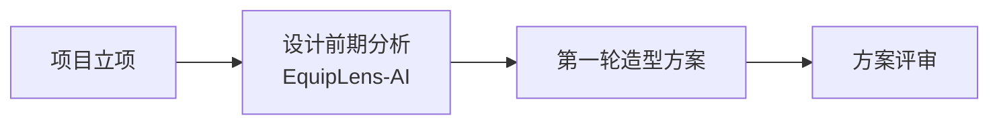
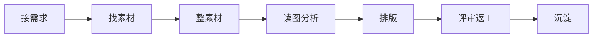
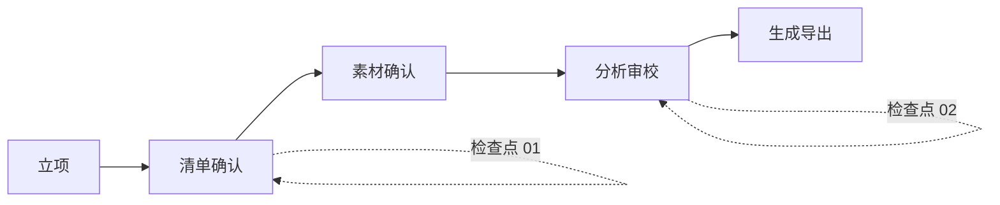
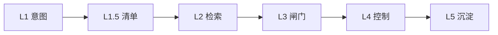
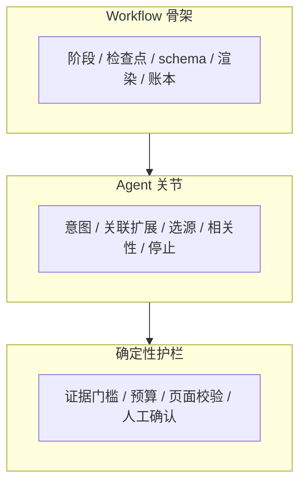

# 业务图与可视化工具调研

> 目的：为产品说明书、PRD、评审材料建立一套可版本化、可复用、可导出印刷的业务图工作流。
> 调研范围：GitHub 上与产品经理、业务分析、架构表达相关的开源项目。
> 说明：GitHub 页面直连偶发超时，以下以仓库主页、README 与公开检索结果为准；正式选型前建议在本地各跑一遍。

---

## 1. 候选项目

| 工具 | 仓库 | 类型 | 最适合 | 局限 |
|---|---|---|---|---|
| Mermaid | [mermaid-js/mermaid](https://github.com/mermaid-js/mermaid) | 文本转图 / DSL | 业务流程图、时序图、旅程图、时间线、思维导图；适合 Git 版本管理 | 自动布局偶有交叉；复杂架构图不够精细 |
| D2 | [terrastruct/d2](https://github.com/terrastruct/d2) | 文本转图 / DSL | 架构图、复杂流程、自动布局；适合工程团队 | 学习曲线高于 Mermaid；生态相对小 |
| draw.io / diagrams.net | [jgraph/drawio](https://github.com/jgraph/drawio) | 可视化编辑器 | 客户交付级流程图、BPMN、UML、架构图；导出 SVG/PDF | 手工维护；版本 diff 不友好 |
| Excalidraw | [excalidraw/excalidraw](https://github.com/excalidraw/excalidraw) | 白板 / 手绘风 | 工作坊、用户旅程、服务蓝图、早期共创 | 不适合正式印刷；精确排版弱 |
| bpmn-js | [bpmn-io/bpmn-js](https://github.com/bpmn-io/bpmn-js) | BPMN 2.0 渲染/建模 | 正式业务流程、需要 BPMN 语义的客户 | 对产品说明书偏重；业务人员学习成本高 |
| React Flow | [xyflow/xyflow](https://github.com/xyflow/xyflow) | 节点式图形库 | 产品内交互式流程编辑器、可视化配置 | 偏前端工程；不是文档工具 |
| AntV X6 | [antvis/X6](https://github.com/antvis/X6) | 图编辑引擎 | 复杂节点图、流程编排界面 | 偏前端工程；需要开发 |
| Structurizr | [structurizr/structurizr](https://github.com/structurizr/structurizr) | C4 架构模型 | 软件架构、系统上下文、容器图 | 只适合架构，不适合业务流程 |
| Kroki | [yuzutech/kroki](https://github.com/yuzutech/kroki) | 统一渲染服务 | 把 Mermaid/PlantUML/Graphviz 等统一转 SVG/PNG | 需要部署；是基础设施不是编辑器 |
| PlantUML | [plantuml/plantuml](https://github.com/plantuml/plantuml) | 文本转图 / UML | 时序图、类图、状态图、部署图 | 默认视觉偏旧；业务流程表达不如 Mermaid 直观 |
| Next AI Draw.io | [chadkunsman/next-ai-draw-io](https://github.com/chadkunsman/next-ai-draw-io) | AI + draw.io | 自然语言生成/修改 draw.io 图，适合草图 | 生成结果需人工校对；社区项目成熟度有限 |
| DeepDiagram | [LingyiChen-AI/DeepDiagram](https://github.com/LingyiChen-AI/DeepDiagram) | AI 可视化 | 自然语言转 Mermaid / 思维导图 / ECharts | 适合初稿；不适合直接交付 |
| journeykit | [malkreide/journeykit](https://github.com/malkreide/journeykit) | 用户旅程 schema | 证据驱动的用户旅程、公共服务场景 | 领域特定；通用性有限 |

补充入口：[GitHub `diagram-as-code` topic](https://github.com/topics/diagram-as-code)、[Mermaid 文档](https://github.com/mermaid-js/mermaid)。

---

## 2. 选型结论

### 主工具链

1. **Mermaid：业务逻辑的标准源**
   - 用于 P02 项目阶段、P03 现状流程、P05 混合编排、P07 端到端流程、P15 证据链、P18 案例流程。
   - 优点：纯文本、可 diff、可在 Markdown/PR 中评审；产品经理不需要打开绘图软件。
   - 用法：先在文档里写 Mermaid，评审逻辑；逻辑稳定后再决定是否精修视觉。

2. **draw.io：印刷级终稿**
   - 用于 P06 对比矩阵、P08 四轴扩展示意、P13 架构图、P16 数据管线等需要精确排版的图。
   - 优点：可编辑、可导出 SVG/PDF，适合客户交付。
   - 用法：Mermaid 确定逻辑 → draw.io 重绘视觉 → 导出 SVG 嵌入说明书 HTML。

3. **D2：复杂架构备选**
   - 当 Mermaid 的自动布局无法表达分层架构时，用 D2 重画 P13。
   - 优点：自动布局更好，适合工程团队维护。
   - 局限：产品经理学习成本更高，不建议作为全量主工具。

### 辅助工具

- **Excalidraw**：用于用户旅程、工作坊、早期共创；不进入最终印刷稿。
- **bpmn-js / Camunda**：仅当客户要求 BPMN 2.0 语义时使用；普通产品说明书不需要。
- **Structurizr**：用于技术架构的 C4 表达；业务流程仍用 Mermaid/draw.io。
- **Kroki**：如果要把 Mermaid 自动渲染进 CI/文档站点，用 Kroki 统一出 SVG。
- **AI 生成图工具**：只用于初稿和头脑风暴；终稿必须人工重绘，避免“看起来像图、但逻辑不成立”。

### 不推荐作为主工具

- **React Flow / AntV X6**：适合做产品内的交互式图形编辑器，不适合做静态说明书。
- **PlantUML**：时序图/类图可以，但业务流程的视觉表达不如 Mermaid 直接。
- **AI 一键生成图**：可以提速，但不能替代产品经理对业务逻辑的抽象。

---

## 3. 本说明书的图表清单

| 页 | 图 | 推荐工具 | 说明 |
|---|---|---|---|
| P02 | 项目阶段图 | Mermaid | 立项 → 设计前期分析 → 第一轮造型 → 方案评审 |
| P03 | 现状流程图 | Mermaid | 接需求 → 找素材 → 整素材 → 读图 → 排版 → 评审 → 沉淀 |
| P04 | 核心价值四象限 | draw.io / HTML | 效率 / 质量 / 可控 / 复用 |
| P05 | 混合编排三层图 | Mermaid 或 draw.io | workflow / agent / guardrails |
| P06 | 竞品对比矩阵 | HTML 表格 | 通用 Agent / AI PPT / 图库+人工 / EquipLens |
| P07 | 端到端业务流程图 | Mermaid | 五阶段、两检查点、三类产物 |
| P08 | 四轴扩展示意 | draw.io | 同类目 / 邻近类目 / 同平台 / 环境特化 |
| P09 | 素材漏斗 + 三篮子 | draw.io / HTML | 105 → 70 → 22 → 3 |
| P10 | 单车页解剖 | 真实截图 + SVG 标注 | 分析字段与版面映射 |
| P11 | Page IR 槽位图 | draw.io / HTML | 版式、槽位、素材、文案、样式 |
| P12 | 裁框编辑器 | 真实截图 | 可编辑性证据 |
| P13 | 整体编排与技术栈图 | draw.io（全页）或 D2 | 五层 + L0–L6 + 三流 + 两闭环 + 技术栈标签 |
| P14 | 数据飞轮 | draw.io / Mermaid | 项目运行 → 沉淀 → 质量锚定 → 复用 → 评测 |
| P15 | 证据链 + 闸门对比 | Mermaid + SVG | L1–L5；40.4% → 6.9% |
| P16 | 数据管线图 | draw.io | 采集 → 登记 → 标准化 → 分析 → 页面 → 交付 → 沉淀 |
| P17 | 评测闭环 | Mermaid | 定义 → 评测 → 对比 → 合入/回滚 |
| P18 | 案例流程 | Mermaid | 沙漠牵引车 9+3、12 页 |
| P19 | 场景矩阵 | HTML 表格 | 任务 / 素材条件 / 收益 |
| P20 | 风险矩阵 | HTML 表格 | 风险 / 表现 / 对策 / 状态 |

> 业务流程是必需项：P03 是“现状流程”，P07 是“产品流程”，两张图必须同时存在。

---

## 4. 落地工作流

```text
产品经理写 Mermaid（逻辑评审）
  → 评审通过
  → 复杂图用 draw.io / D2 重绘（视觉精修）
  → 导出 SVG
  → 嵌入说明书 HTML / PPT
  → Mermaid 源文件保留在 docs/，便于后续版本 diff
```

原则：

1. **逻辑与视觉分离**：Mermaid 负责“逻辑对不对”，draw.io 负责“看起来是否专业”。
2. **图必须可 diff**：业务逻辑变更应能在 Git 中看到，而不是只存在于某个 `.drawio` 二进制文件。
3. **终稿用 SVG**：印刷/PDF 不放 PNG 截图（产品界面截图除外）。
4. **AI 只做初稿**：自然语言生成的图必须人工校对节点、连线、语义。
5. **一图一问**：每张图只回答一个问题；图中文字不超过 40 个；图下写一句结论。

---

## 5. Mermaid 示例

### 5.1 项目阶段（P02）



### 5.2 现状流程（P03）



### 5.3 端到端产品流程（P07）



### 5.4 证据链（P15）



### 5.5 混合编排（P05）



---

## 6. 风险与边界

- Mermaid 的自动布局在复杂图上会出现交叉；不要强行用它画所有图。
- draw.io 是手工维护，必须约定“图源文件 + SVG + 说明文字”三件套。
- AI 生成图容易“形式正确、语义错误”；终稿必须人工核对每个节点和箭头。
- 业务流程图的节点应与 PRD 的阶段、产物、检查点一一对应，不能为了好看加节点。
- 架构图不要混入部署细节；本说明书已删除部署内容。
