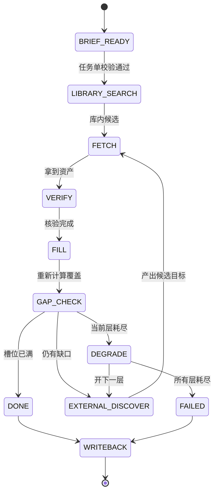
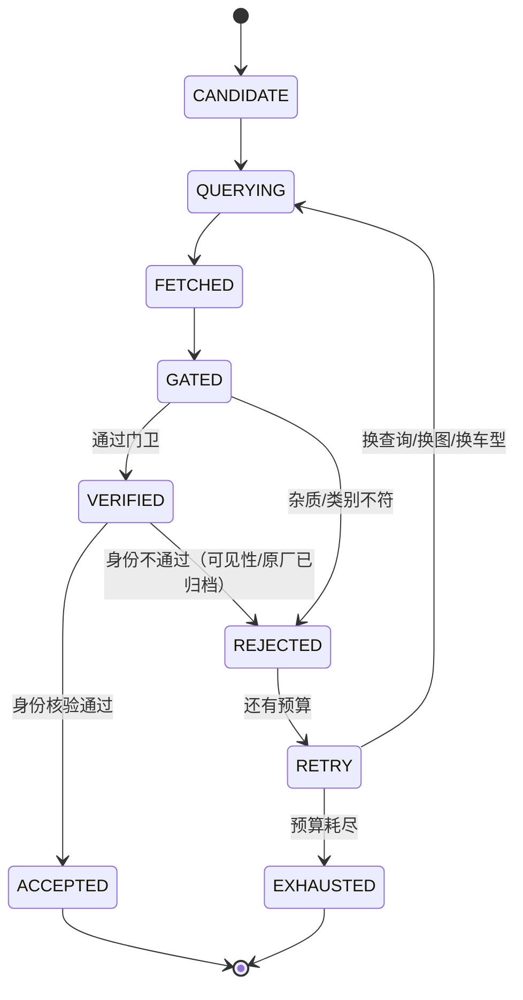

# 检索中状态机（v0.1）

| 属性 | 内容 |
|---|---|
| 日期 | 2026-11-09 |
| 阶段 | **检索中**（pre-retrieval 输出任务单之后，post-retrieval 证据核验之前） |
| 作用 | 定义检索 loop 的状态、转移、检查点、失败处理 |
| 不是 | 不是策略库（策略是“怎么做”，状态机是“走到哪、下一步走哪条边”） |
| 不是 | 不是自由 Agent；所有循环有界，所有转移可审计 |
| 格式 | Mermaid 图 + 文本图 + 状态表；Mermaid 可在 GitHub/Obsidian 直接渲染 |

---

## 0. 一句话

检索中是一个**有界、可检查点、可回放**的状态机：从任务单开始，先查库，再补外检，逐候选核验，填槽，降级或停止，最后回写证据。

---

## 1. 顶层状态机（Mermaid）



> 代码实现里，`WRITEBACK` 落盘后会把 `state` 置为 `final_state`（`DONE`/`FAILED`）并结束；事件日志因此会多一条 `WRITEBACK → DONE/FAILED`，属于收口动作。

---

## 2. 文本版（不看 Mermaid 也能读）

```
BRIEF_READY
  ↓
LIBRARY_SEARCH ─┐
                ├→ FETCH → VERIFY → FILL → GAP_CHECK
EXTERNAL_DISCOVER ┘                         │
                                            ├─ 槽满 ─────────────► DONE ─► WRITEBACK
                                            ├─ 有缺口且本层未试 ─► EXTERNAL_DISCOVER
                                            └─ 本层已试 ─► DEGRADE
                                                             ├─ 有下一层 ─► EXTERNAL_DISCOVER
                                                             └─ 无下一层 ─► FAILED ─► WRITEBACK
```

---

## 3. 状态表

| 状态 | 目的 | 输入 | 输出 | 下一步 | 失败/异常 |
|---|---|---|---|---|---|
| `BRIEF_READY` | 校验任务单与预算 | `brief.json` | 校验后的 state | `LIBRARY_SEARCH` | schema 错 → 直接失败，不检索 |
| `LIBRARY_SEARCH` | 先查库内已有素材/证据 | brief、库索引 | 候选目标 + 资产 | `FETCH` | 库空 → 仍走 `FETCH`（空资产） |
| `FETCH` | 抓取/下载/去重/门卫 | 候选目标 | 资产 + 通道状态 | `VERIFY` | 被拦/空 → 记录失败，`VERIFY` 里判不通过 |
| `VERIFY` | **身份核验**（型号码/品牌车系/构型）；（② 可见性 / ③ 原厂已归档，见 `docs/killed-strategies.md` K1/K2） | 资产、部件验收 | 通过/不通过 + 缺陷标签 | `FILL` | 不通过 → 不占槽；P1 不做 RETRY |
| `FILL` | 占槽/备选/族去重 | 通过证据、槽位 | 新覆盖 | `GAP_CHECK` | 槽满 → `GAP_CHECK` 判 `DONE` |
| `GAP_CHECK` | 判断全局槽位/部件覆盖 | 候选、配额、验收 | 缺口清单 | `DONE` / `EXTERNAL_DISCOVER` / `DEGRADE` | 全局槽满 → `DONE` |
| `EXTERNAL_DISCOVER` | 找车型/来源/查询目标 | 缺口、层级、源注册表 | 候选目标（不保证有图） | `FETCH` | 无候选 → `DEGRADE` |
| `DEGRADE` | 开下一层/跨类 | 当前层耗尽、预算 | 新层级/停止 | `EXTERNAL_DISCOVER` / `FAILED` | 所有层耗尽 → `FAILED` |
| `DONE` | 正常收口 | 覆盖 | 命中单 | `WRITEBACK` | — |
| `FAILED` | 缺口收口 | 覆盖、原因 | 缺口报告 | `WRITEBACK` | — |
| `WRITEBACK` | 回写证据/缓存/事件 | 命中单 | `image_evidence`、可行性索引 | 结束 | 写失败 → 保留临时文件，重试 |

---

## 4. 候选子状态（单个目标/单张图）



候选级的关键点：

- 每次重试必须**换一个变量**（查询/图/车型/来源），不能原样重试；
- 重试预算按候选/目标/单元三级记；
- `EXHAUSTED` 不是失败，是“这个候选没戏”，回到 `DEGRADE` 或下一个候选。

> **P1 实现范围**：当前代码只做到“核验不通过 → 不占槽 → 进下一层”；独立的 `RETRY/EXHAUSTED` 是 P3–P4 的目标，先把状态图画出来。

---

## 5. 检查点与事件

### 5.1 检查点字段

```json
{
  "run_id": "run-20261109-001",
  "brief_id": "b-20261109-001",
  "state": "VERIFY",
  "round": 2,
  "unit_id": "u-step",
  "target_id": "t01",
  "candidate_id": "c03",
  "budget": {"queries_used": 7, "models_used": 3, "retries_used": 1},
  "coverage": {"slots_filled": 5, "slots_target": 12, "parts_filled": 4},
  "decisions": [
    {"at": "GAP_CHECK", "action": "open_environment", "reason": "exact 层只填了 5/12"}
  ],
  "updated_at": "2026-11-09T03:00:00+08:00"
}
```

- 落盘时机：每次状态转移后；
- 原子写：临时文件 + rename；
- 恢复：从最后一个完整检查点继续，已完成的步骤幂等跳过。

### 5.2 幂等键

```
(run_id, unit_id, target_id, candidate_id, step)
```

同一键重复执行，直接返回已存结果，不重复抓取/不重复计费。

### 5.3 事件日志

```json
{"ts": "...", "run_id": "...", "state": "VERIFY", "action": "identity_check",
 "input_ref": "asset:123", "output_ref": "evidence:456",
 "decision": "rejected", "reason": "wrong_config"}
```

事件日志用于：审计、回放、调试、评估、向用户解释“为什么降级”。

---

## 6. 失败分类（统一口径）

| 分类 | 含义 | 处理 |
|---|---|---|
| `blocked` | 通道被拦/验证码 | 换源/熔断/退避 |
| `empty` | 通道正常但无结果 | 换查询/换源 |
| `wrong_identity` | 不是这台车/型号 | 换候选/换查询 |
| `wrong_config` | 构型不符（6×6 vs 6×2） | 换候选/换查询 |
| `part_not_visible` | 部件不可见/不可裁 | 换图/换车型 |
| `low_resolution` | 分辨率不足 | 换图/换源 |
| `duplicate` | 重复资产 | 跳过 |
| `budget_exhausted` | 预算到顶 | 降级/收口 |
| `no_candidate` | 该层没有候选 | 开下一层 |

**原则**：`blocked`/`empty` 不能混为“没找到”；`wrong_identity` 不能当成“没图”；每种失败都要能回答“下一步换什么”。

---

## 7. 与检索前/检索后的边界

| 阶段 | 产物 | 状态机的位置 |
|---|---|---|
| 检索前 | 任务单（brief） | 状态机的输入；不读库、不联网 |
| 检索中 | 命中单（hits） | 本状态机；读库、联网、核验、填槽 |
| 检索后 | 证据单（evidence） | 状态机的 `WRITEBACK` 之后；证据库/分析/排版 |

**注意**：`VERIFY` 在检索中，不在检索后。检索后是“把通过核验的记录写成证据单并回写库”，不是“第一次核验”。

---

## 8. 怎么测试这个状态机

1. **夹具测试**：用假适配器（fake library / fake search / fake verifier）跑完整 loop；
2. **崩溃恢复**：在任意状态中断，重启后从检查点继续，不重复抓取；
3. **幂等测试**：同一候选重复执行，结果一致、不重复计费；
4. **场景测试**：
   - 库内全满足 → 不触发外检；
   - 库内部分满足 → 外检补缺；
   - 通道全被拦 → 熔断 + 缺口报告；
   - 身份错 → 换候选，不占槽；
   - 预算耗尽 → 降级/收口；
5. **回放测试**：同一 brief + 同一批 fixture，覆盖/决策一致。

---

## 9. 这张图不是什么

- 不是“用户流程图”：用户只看到第一批结果和最终结果，不看到状态机内部；
- 不是“策略图”：查询阶梯、源路由、验收规则在策略库里，状态机只调用；
- 不是“无限循环”：每个 loop 都有预算和停止条件；
- 不是“全流程 LangGraph”：只有检索中这一段在状态机/图里，前后都是普通模块。
